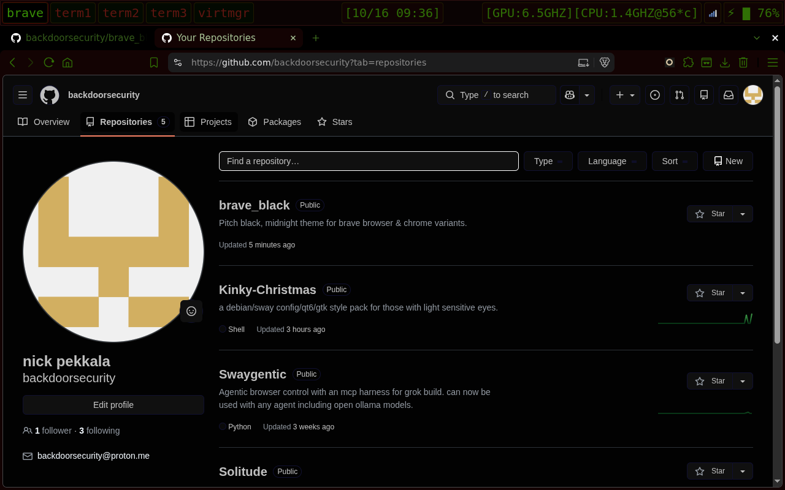

# brave_black

```bash
git clone https://github.com/backdoorsecurity/brave_black.git
```
- Extensions -> check developer options.
- load unpacked -> select brave_black folder, enjoy the night.
  
  
   

